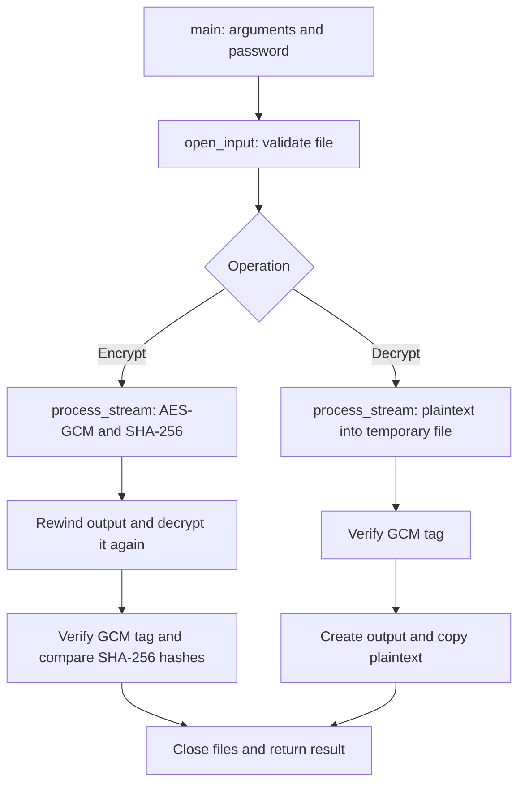

# Developer documentation: filecrypter2

This guide describes the current implementation, its structure and its contracts.
For user instructions and platform-specific builds, see [README.md](README.md).
For security assumptions and improvements, see [SECURITY.md](SECURITY.md).

## 1. Architecture and repository

`filecrypter2` is a synchronous command-line application written in C11. The
entire production implementation lives in one source file. There are no
background processes, network requests, configuration files or mutable global
state. OpenSSL provides random number generation, key derivation, AES-GCM and
SHA-256.

| File | Purpose |
| --- | --- |
| [filecrypter.c](filecrypter.c) | CLI, platform-specific file operations, cryptography and control flow |
| [CMakeLists.txt](CMakeLists.txt) | Build, compiler warnings, installation, tests and sanitizer option |
| [tests/test_cli.py](tests/test_cli.py) | Functional tests through the public command-line interface |
| [tests/interop.py](tests/interop.py) | Independent file format checks using Python cryptography |
| [tests/fixtures](tests/fixtures) | Fixed test vectors for format versions 1 and 2 |
| [.github/workflows/ci.yml](.github/workflows/ci.yml) | Builds and tests on Linux, macOS and Windows |
| [LICENSE](LICENSE) | Project MIT license |



`main()` coordinates these steps and owns the open streams. Each helper handles
a specific part of the operation. All helpers are `static`; they do not expose
a public library API.

## 2. Command line and parameters

```text
filecrypter2 INPUT OUTPUT PASSWORD
filecrypter2 --decrypt INPUT OUTPUT PASSWORD
filecrypter2 --help
filecrypter2 -h
```

| Parameter | Meaning and validation |
| --- | --- |
| `INPUT` | Existing regular file, opened read-only in binary mode; empty files are supported |
| `OUTPUT` | New output file; existing destinations are rejected |
| `PASSWORD` | Nonempty password argument, or `-` to read a password line from stdin |
| `--decrypt` | Must appear first; encryption is the default without this option |
| `--help`, `-h` | Display help; must be the only argument |

Exactly three positional parameters are required. Empty parameters, unknown
options and an incorrect argument count cause an error before any file is
opened. There is no general-purpose option parser or `--` separator. When
encrypting, prefix input filenames beginning with a dash with a directory,
for example `./-file`.

With `PASSWORD=-`, `fgets()` reads an LF-terminated line into a 1024-byte buffer.
The trailing LF and an immediately preceding CR are removed. The documented
limit is 1022 password bytes; NUL and embedded newlines are unsupported. No
Unicode normalization is performed. The program does not disable terminal echo.
See the README for a shell example that hides password input. A direct password
argument may be visible in process listings and shell history.

Successful operations and help return exit code `0`. Handled errors return `1`
and print an error message and usage to stderr. Explicit help goes to stdout;
successful file operations currently produce no status output.

## 3. Encryption flow

1. `main()` validates arguments and the password, then opens the input with
   `open_input()`.
2. `create_output()` exclusively creates the destination as a readable and
   writable binary stream. Existing files are not opened for writing.
3. `process_stream(..., decrypt=0, digest)` creates the header, derives the key
   and encrypts the input in chunks. It also computes SHA-256 over the plaintext
   bytes actually read. Finally, it writes the GCM authentication tag.
4. `main()` checks `fflush()` and rewinds the output with
   `fseek(..., 0, SEEK_SET)`.
5. `process_stream(out, NULL, password, 1, verified)` rereads the same open output
   file. It decrypts the content, verifies the GCM tag and computes the plaintext
   hash. Passing `NULL` as the output stream discards the decrypted content.
6. `CRYPTO_memcmp()` compares the two 32-byte hashes. The operation succeeds
   only after verification and successful closure of the streams.

Verification reads the generated file rather than reopening the original input.
It therefore compares the encrypted content against the bytes actually processed.
Both passes derive the key separately, so encryption performs two scrypt
computations. Verification reads through the filesystem cache and does not
provide power-loss durability: there is no `fsync()` call or atomic publication
through a final rename.

## 4. Decryption flow

1. `open_input()` validates the encrypted input file.
2. `private_temp()` creates a temporary stream for plaintext.
3. `process_stream(..., decrypt=1, digest)` reads and validates the header,
   derives the key and decrypts into the temporary file.
4. Only `EVP_CipherFinal_ex()` confirms authenticity using the GCM tag. Until
   this succeeds, the generated plaintext is untrusted.
5. After successful authentication, the temporary file is prepared for reading:
   `fflush()` writes buffered data and `fseek()` resets the read position.
   The file contents are retained.
6. Only then does `create_output()` create the destination. `copy()` transfers
   the authenticated plaintext to it, and all streams are closed.

Important for extensions: `process_stream()` may have written plaintext before
returning `0` because of an invalid tag. Callers must not publish or consume
that data. The current caller protects against this with the temporary file;
encryption verification discards decrypted content entirely.

Decryption requires temporary disk space for a complete plaintext copy. During
the final copy, the temporary file and destination may together occupy roughly
twice the plaintext size.

## 5. Function reference

| Function | Contract |
| --- | --- |
| `open_input(path, decrypt)` | Returns an open `FILE*` or `NULL`. Checks type and size on the already open descriptor. The caller owns closure. `decrypt` increases the allowed input size by the format overhead. |
| `create_output(path)` | Exclusively creates a new `w+b` stream. Returns `NULL` for an existing destination or another error. If stream creation fails after creating the file, the new file is removed. |
| `private_temp()` | Returns a temporary `w+b` stream or `NULL`; closing it triggers automatic file deletion. |
| `put(out, data, n)` | Writes exactly `n` bytes. Returns `1` on success or `0` on a short write. With `out=NULL`, intentionally discards data and returns `1`. |
| `process_stream(in, out, password, decrypt, digest)` | Encrypts or decrypts from the current input position. `decrypt=0` encrypts; `decrypt=1` decrypts. Returns `1` only after successful completion; then `digest` contains SHA-256 of the plaintext. Does not close supplied streams. |
| `copy(in, out)` | Copies chunks from the current stream positions, checks read/write errors and clears its plaintext buffer. Returns `1` or `0`; does not close streams. |
| `usage(stream)` | Writes CLI help to the supplied stream. |
| `main(argc, argv)` | Validates inputs, controls both operations, checks results, closes resources and determines the exit code. |

The processing helpers' `1`/`0` convention differs from the program's exit codes.
Do not treat `digest` as valid when `process_stream()` returns `0`.

## 6. Cryptography and binary file format

Symmetric encryption uses AES-256-GCM with a 32-byte key, 12-byte nonce and
16-byte tag. Each encryption generates the salt and nonce together as 28 fresh
random bytes using `RAND_bytes()`.

For a plaintext size of `P`, the total file size is `P + 52` bytes:

| Byte offset | Length | Content |
| --- | --- | --- |
| 0 | 7 | ASCII identifier `FCRYPT2` |
| 7 | 1 | Binary format version: `0x01` or `0x02`, not an ASCII digit |
| 8 | 16 | scrypt salt |
| 24 | 12 | GCM nonce |
| 36 | `P` | Ciphertext |
| `36 + P` | 16 | GCM authentication tag |

The complete 36-byte header is processed as Additional Authenticated Data (AAD).
It is readable but authenticated. There are no separate length fields, padding
or stored SHA-256 hashes. All multi-byte fields are byte sequences; integer
endianness does not apply. An encrypted empty file therefore occupies 52 bytes.

| Format version | scrypt `N` | `r` | `p` | Approximate working memory | Use |
| --- | --- | --- | --- | --- | --- |
| 1 | 32768 | 8 | 1 | 32 MiB | Decryption of existing files only |
| 2 | 131072 | 8 | 1 | 128 MiB | All newly encrypted files |

`EVP_PBE_scrypt()` also receives a memory ceiling of 256 MiB. This ceiling is
not the normal memory requirement. Parameters are fixed by the format version;
the file cannot specify arbitrary KDF costs. Unknown versions are rejected
before key derivation. The format version is independent of the CMake project
version.

### Chunk and tag processing

`CHUNK=65536` means 64 KiB of plaintext per processing step. Buffers include
additional space for the tag. Decryption always retains the last 16 input bytes.
Only at EOF are these supplied as the tag using `EVP_CTRL_GCM_SET_TAG`. All
preceding bytes after the header are treated as ciphertext. Truncated files
and appended bytes are therefore rejected during final authentication.

`EVP_CipherUpdate()` processes data; `EVP_CipherFinal_ex()` completes the
operation and checks the tag during decryption. Encryption retrieves the tag
using `EVP_CTRL_GCM_GET_TAG` and writes it after finalization.

## 7. File operations, resources and errors

`MAX_PLAINTEXT` limits files to 32 GiB of plaintext. `FORMAT_OVERHEAD=52`
increases the maximum encrypted input size accordingly. Size is checked both
on the open descriptor before processing and while streaming. The streaming
check keeps processing within the GCM limit as well.

| Area | POSIX: Linux and macOS | Windows |
| --- | --- | --- |
| Input | `open(O_RDONLY \| O_NONBLOCK)`, `fstat()`, `S_ISREG()` and `fdopen()` | `_open()`, `_fstat64()` and `_fdopen()` in binary mode |
| Output | `O_CREAT \| O_EXCL \| O_RDWR`, mode `0600` | `_O_CREAT \| _O_EXCL \| _O_RDWR \| _O_BINARY`; access also depends on the directory ACL |
| Temporary file | Standard `tmpfile()` function | `GetTempPathA()`, random name, `CreateFileA(CREATE_NEW)` without sharing and with `FILE_FLAG_DELETE_ON_CLOSE` |
| Large files | `_FILE_OFFSET_BITS=64` build definition | 64-bit file metadata through `_stat64` |

Nonblocking open on POSIX prevents waiting on a FIFO before checking its type.
Directories and device files are also rejected. Input symlinks are permitted
if the opened target is a regular file. Existing output destinations, including
symlinks and hardlink aliases, fail exclusive creation.

Windows currently uses narrow-string APIs and `MAX_PATH` for the temporary
path. Full Unicode and arbitrarily long path support are not implemented
contracts.

`main()` uses a shared `done` cleanup path. All open streams are closed even
on failure; close errors also make the operation fail. An output created by
this invocation is removed on error. Failure to remove it is reported separately.
Existing destinations are not opened or removed by this cleanup. A process
abort or power failure can still leave an incomplete new output.

`process_stream()` frees its OpenSSL contexts and clears key and data buffers
with `OPENSSL_cleanse()`. The stdin password buffer and copy buffer are also
cleared. These measures guarantee neither removal of every possible copy in
process memory nor secure deletion of plaintext from storage or swap. The
password argument in `argv` is not overwritten.

The application assumes directories controlled by the user. Concurrent changes
to inputs and attackers with write access to the participating directories
are outside the documented threat model. Further limitations are described
in the README and `SECURITY.md`.

## 8. Development setup and checks

Requirements are CMake 3.20 or newer, a C11 compiler and OpenSSL 3.0 or newer
with its Crypto component. Regular tests require Python 3 but no additional
Python packages.

```sh
cmake -S . -B build -DCMAKE_BUILD_TYPE=Debug
cmake --build build --config Debug
ctest --test-dir build -C Debug --output-on-failure
```

See the README for platform-specific OpenSSL paths and the Windows vcpkg
command. Multi-configuration generators such as Visual Studio place executables
in configuration subdirectories, for example `build/Debug`.

| CMake option | Default | Meaning |
| --- | --- | --- |
| `BUILD_TESTING` | `ON` | Registers the `cli_security` CTest test and requires Python 3 |
| `FILECRYPTER_SANITIZE` | `OFF` | Enables AddressSanitizer and UndefinedBehaviorSanitizer for GCC/Clang; rejects other compilers when enabled |
| `CMAKE_BUILD_TYPE` | Generator-dependent | For example `Debug` or `Release` with single-configuration generators |
| `OPENSSL_ROOT_DIR` | Automatic discovery | Optional hint identifying an OpenSSL installation |

A build without tests does not require Python:

```sh
cmake -S . -B build-release -DBUILD_TESTING=OFF -DCMAKE_BUILD_TYPE=Release
cmake --build build-release --config Release
cmake --install build-release --config Release --prefix /your/install/prefix
```

Sanitizer checks:

```sh
cmake -S . -B build-sanitize -DFILECRYPTER_SANITIZE=ON -DCMAKE_BUILD_TYPE=Debug
cmake --build build-sanitize
ctest --test-dir build-sanitize --output-on-failure
```

### Test organization

CTest invokes `tests/test_cli.py` with the path to the built executable. It
checks arguments, help, round trips including empty files and chunk boundaries,
different ciphertexts for identical inputs, tampering, wrong passwords, format
versions, existing destinations and file aliases. POSIX-specific cases also
check FIFOs, device files, oversized sparse files and cleanup after write errors.
Unavailable platform features are skipped as appropriate.

The fixed JSON test vectors contain passwords, plaintext and ciphertext as
test data. These passwords and deterministic random values must not be used
for real data.

`tests/interop.py` checks C-generated files with Python `hashlib.scrypt` and
`cryptography`'s `AESGCM`. It requires the optional `cryptography` package;
this is not a runtime dependency of the program. Run this check separately:

```sh
python tests/interop.py build/filecrypter2
```

`python tests/interop.py --fixture` prints the fixed version 2 test vector as
JSON to stdout. The regular CLI suite decrypts the existing vectors for both
versions without additional Python cryptography packages.

GitHub CI builds and tests on all three operating systems. Linux additionally
runs the sanitizer suite. CI uses read-only repository permissions, enforces
a time limit and cancels obsolete runs in the same workflow/ref group.

## 9. Guidelines for changes

- **Version the file format:** Changes to KDF parameters, header layout or
  cryptographic algorithms require an explicit compatibility decision and a new
  format version when interpretation is incompatible. Never silently reinterpret
  an existing version.
- **Preserve authentication:** Both header and payload must remain authenticated.
  Decrypted content must not be treated as trusted until tag verification succeeds.
- **Preserve file contracts:** Never overwrite existing destinations. Check write,
  flush, seek and close errors; review error handling and cleanup alongside the
  successful path.
- **Keep limits consistent:** Changes to header or tag sizes must update size
  checks, `FORMAT_OVERHEAD`, buffer logic, test vectors and documentation.
- **Validate relevant behavior:** Add a suitable regression test for behavior
  changes. Check cryptographic changes against an independent implementation
  and on the supported platforms as well.
- **Keep commits focused:** Give each commit one concrete goal. Revisit resource
  ownership, error paths and security consequences after a change.
